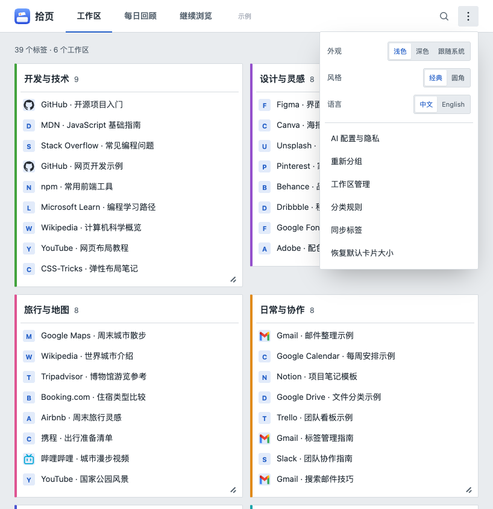

# 菜单与品牌更新

已按原型将更多菜单中的设置排列为三行：外观（浅色／深色／跟随系统）、风格（经典／圆角）、语言（中文／English）。每行左侧标签，右侧并排选项。

界面品牌、页面标题及扩展名称已更新：中文“拾页”，英文“Tabkeep”。规则导出文件使用 `tabkeep-rules-日期.json`；存储键与备份格式保持兼容，历史补分类等业务功能未改变。

84 项测试及静态检查通过；Chrome 验证了三行布局、选项切换、刷新后保存、中英文名称和 320 像素窄屏。刷新面板即可看到界面变化，扩展管理页名称需要重新加载扩展。

