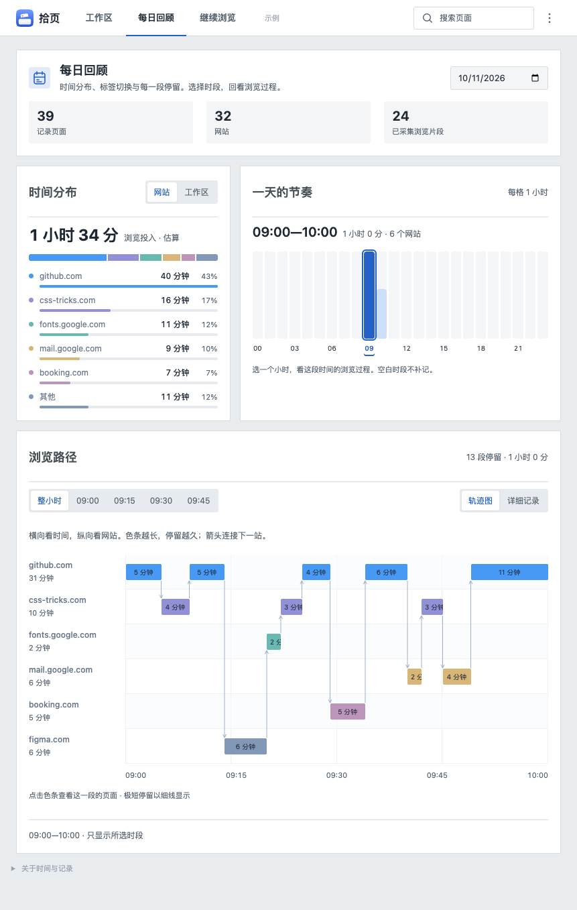
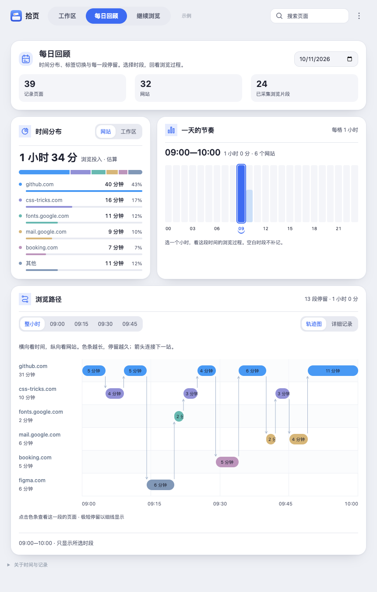

# 原型对齐与响应式修复

已修复用户指出的每日回顾缩放异常，并再次对照 [tabkeep-prototype.html](../archive/2026-10-26/tabkeep-prototype.html) 调整现有页面。

## 修复与对齐

- 将工作区卡片宽度规则限定到工作区列表，防止经典主题在中等屏幕宽度下把回顾卡片再次缩窄。回顾卡片始终填满所在列，浏览路径始终占满内容宽度。
- 回顾按原型在 720 像素以下使用单列，宽屏使用两列；标题不再逐字换行。
- 时间分布改为原型的总时长、堆叠占比条、网站／工作区列表、百分比和横条。仍使用原有真实浏览时长，切换维度和搜索范围均保留。
- 小时图保持单排；空间不足时显示每三小时及当前选中小时的刻度，所有小时仍可点击或使用键盘访问，也保留夏令时日期的实际小时数。
- 对齐统计摘要、桌面搜索入口和桌面设置侧面板；经典／圆角、深浅色和中文／英文继续使用原有偏好保存机制。
- 收紧浏览详情列表的间距，保持大量记录的分页与展开功能。

## 功能保护与验证

未改动后台记录、恢复、分类或存储逻辑。历史补分类的范围确认、本地规则优先、可选 AI、分批提交及已有／人工分类保护保持不变。

- 84 项测试通过；语法、元素引用、权限、CSP 和差异格式检查通过。
- 经典／圆角 × 浅色／深色 × 13 个宽度 × 3 个页面，共 156 种布局组合通过。新增检查卡片是否填满列宽、分布标签是否可读、标题是否被挤成竖排，避免只检查页面溢出而漏报。
- Chrome 功能回归通过：工作区搜索、详情、规则、排除、排序、卡片缩放、自动 AI 增量分类、中英文及跨面板偏好、回顾小时／十五分钟筛选、轨迹和 720 段记录的分页。
- 历史补分类浏览器回归通过，包括确认／取消、仅规则、无 Key、可选 AI、人工分类保护及不打开标签。AI 使用模拟响应，未发送个人数据。

刷新面板即可查看新版。完整 36 张截图位于 [prototype-redesign](../archive/2026-10-26/screenshots/prototype-redesign/)。

## 861 像素 · 经典主题

## 861 像素 · 圆角主题

