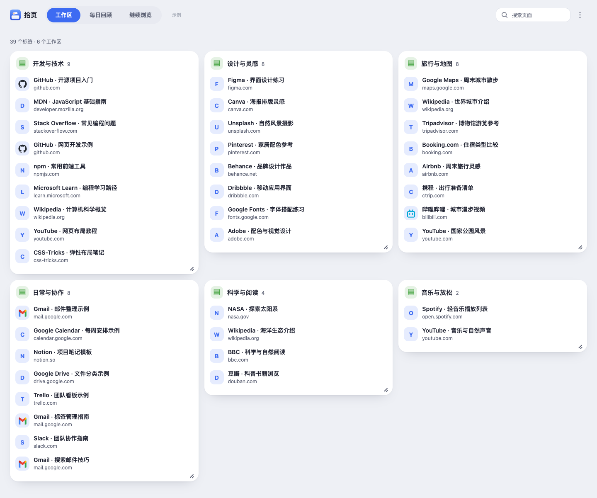
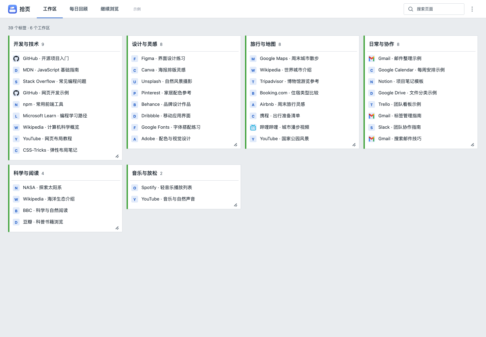
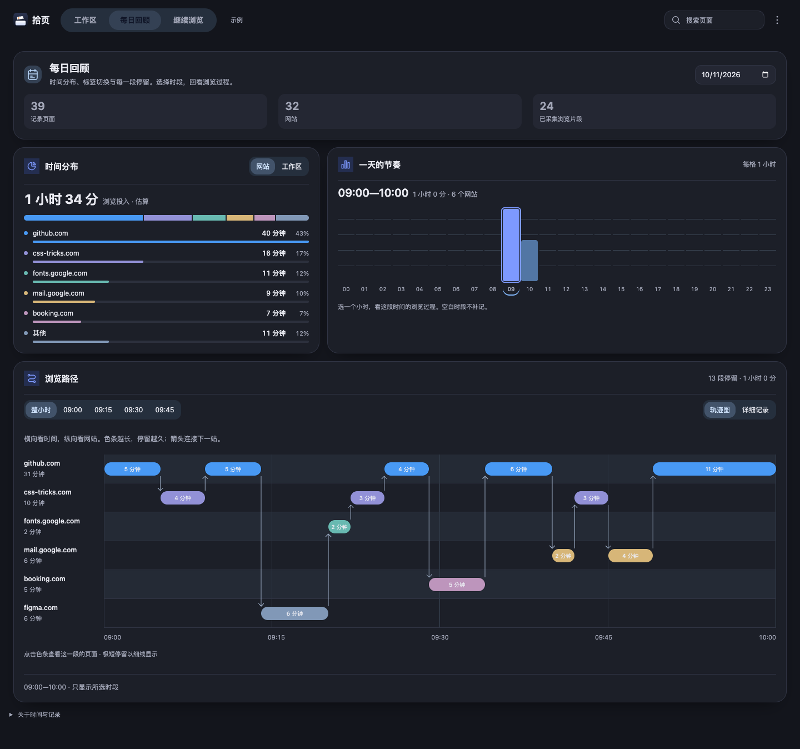
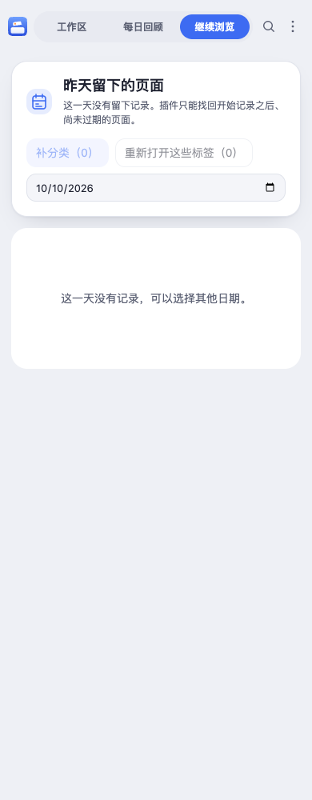

# 原型设计落实

以用户提供的 [tabkeep-prototype.html](../archive/2026-10-26/tabkeep-prototype.html) 为视觉参考：紧凑单行导航、浅灰背景、经典主题的细边框与侧边分类色条、圆角主题的胶囊导航与柔和卡片；侧边栏单列、整页多列。

保留 Tabtrail 名称和全部真实业务逻辑。外观、语言和主题入口收进更多菜单；搜索保持原有范围。历史补分类与恢复操作同列展示。每日回顾沿用真实计时、小时筛选、轨迹和详情，不引入原型的虚构统计或专注判断。

使用系统字体，不加载原型的远程字体。保留键盘操作、可调整卡片、排序、规则、导入导出、供应商设置、暂停与隐私控制；浅色、深色及双语都适配经典和圆角主题。

## 已完成与使用

重新加载 Chrome 中原安装的扩展，再打开面板即可使用。颜色模式、语言和经典／圆角切换位于右上角“更多”菜单；其余业务入口保留。历史补分类继续使用已修复的范围确认、分批处理和人工分类保护逻辑。

当时新增的原型样式已于 2026-10-26 清理，当前界面不再引用它。此处保留历史实现说明；没有改动后台记录、分类、恢复或存储逻辑。原型中未实现于现有产品的关闭整组、新窗口迁移等示例操作未添加，避免改变功能范围。

## 验证结果

- 84 项单元与工作流测试通过；语法、元素引用、权限、CSP 检查通过。
- Chrome 工作区回归通过：搜索、详情、规则编辑、排除网站、拖动排序、卡片缩放与尺寸保存、自动 AI 增量分类和多面板同步。
- 历史补分类浏览器回归通过：确认与取消、仅本地规则、无 Key、可选 AI、保留已有分类与人工调整、不打开标签。
- 每日回顾与双语回归通过：小时／十五分钟筛选、轨迹和详情、空状态、语言保存及跨面板同步。
- 经典／圆角 × 浅色／深色 × 320、390、768、1024、1440 像素 × 三个页面的布局检查通过，无横向溢出或导航重叠。
- 浏览器测试使用虚构数据；AI 请求使用模拟响应，没有向供应商发送个人记录。

## 实际界面截图

完整 24 张截图位于 [prototype-redesign](../archive/2026-10-26/screenshots/prototype-redesign/)，包含工作区、每日回顾、继续浏览的桌面和侧边栏宽度，两种主题及深浅色。

### 圆角 · 桌面

### 经典 · 桌面

### 圆角 · 深色每日回顾

### 侧边栏 · 继续浏览

